# Raisa Vanessa — Luxury Fashion E-commerce

**Storefront, bespoke ordering and back office for a designer fashion label**: editorial collection pages, size and colour stock, made-to-measure requests, appointments, multi-currency checkout with installments, and a Turkish storefront alongside the English one.


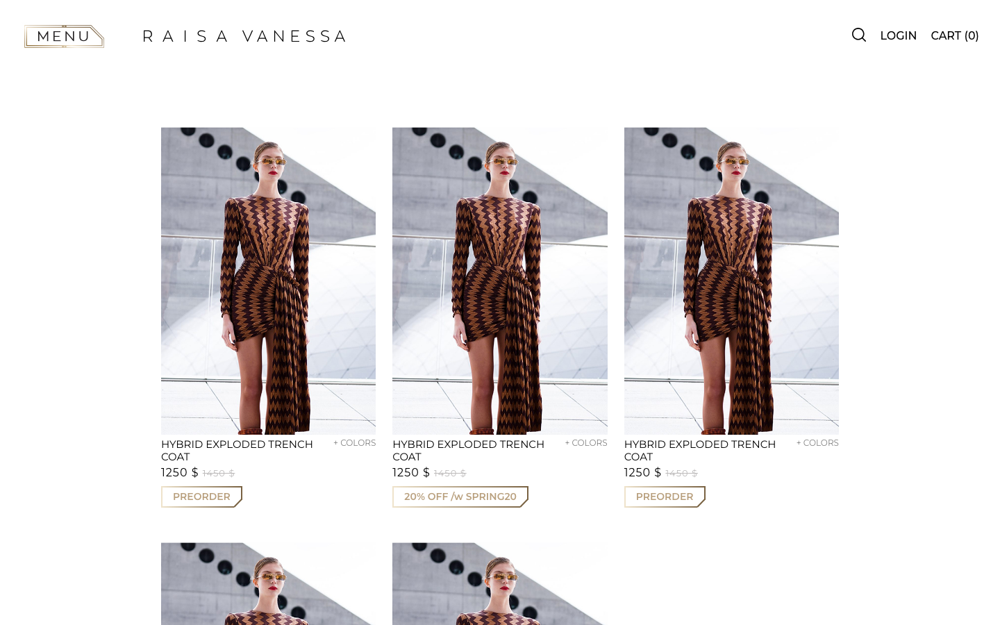

| | |
|---|---|
| **Role** | Lead web developer at MakingKnowing: design implementation, storefront and back office |
| **Period** | 2019 |
| **Markets** | English storefront + Turkish storefront, multi-currency |
| **Stack** | PHP · CodeIgniter 3 · MySQL · jQuery · Owl Carousel · Fancybox · Plyr (Vimeo) · iyzico · Google Maps |

## Highlights

- **Editorial shopping.** Collection pages with campaign video (Plyr over Vimeo), looks, archive and press pages, plus "What to wear with" cross-selling on every product.
- **Size × colour stock matrix.** Products carry colour swatches and sizes. The admin edits stock per colour/size pair in a single grid (`Admin/Products::stocs`).
- **Bespoke (made-to-measure).** Customers send their measurements on a body diagram and attach notes or links. Requests land in the back office as offers.
- **Multi-currency checkout with installments.** Prices follow the session currency. Exchange rates are refreshed from the admin. The card BIN is checked with iyzico to show installment options and whether 3D Secure is required, with separate 3D and non-3D payment paths (`Ajax::Bin`, `Basket::iyzipay`).
- **Appointments and stockists.** Showroom rendezvous booking, a stockist finder on Google Maps, newsletter and customer-service requests that the team marks as inspecting or resolved.
- **Merchant feed.** `Home::xml` publishes a Google Merchant-style RSS product feed.
- **Two storefronts.** The Turkish site (`app/tr/`) runs as its own CodeIgniter application next to the English one.

## Architecture

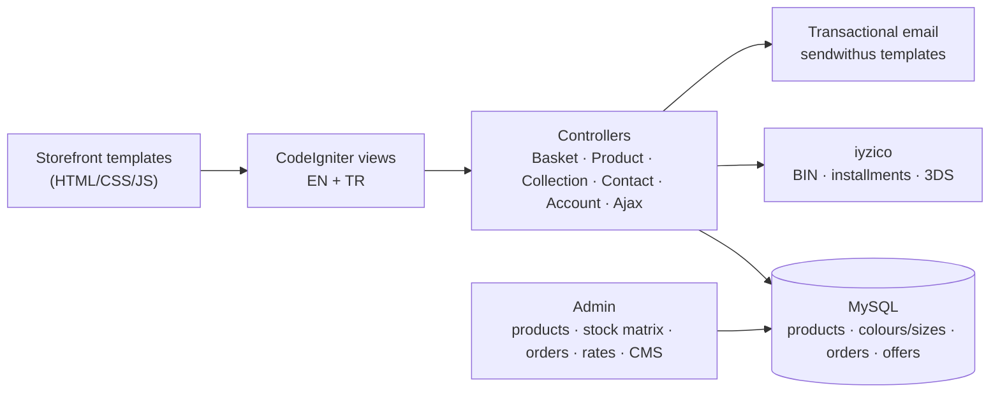

## Screens

| | |
|---|---|
| 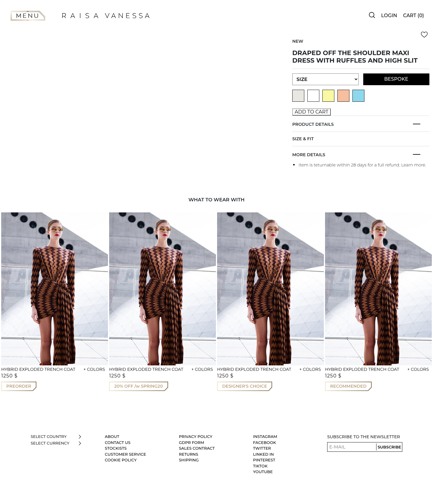 **Product detail:** size, colour swatches, bespoke CTA, details and "what to wear with" | 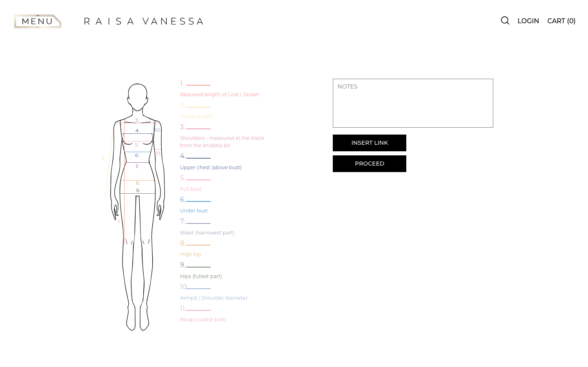 **Bespoke request:** measurements on a body diagram |
| 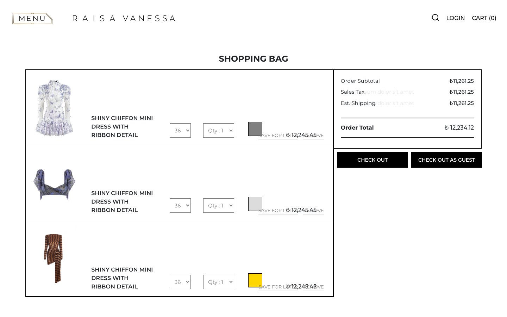 **Shopping bag** with per-line size, quantity and colour | 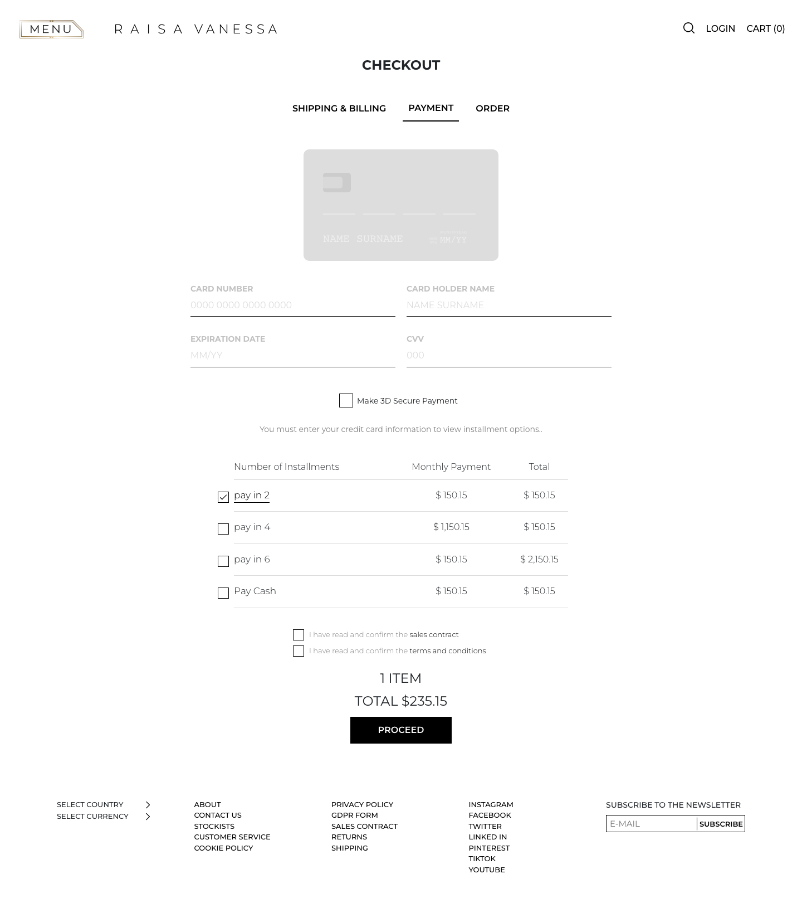 **Checkout:** card form and installment table |
| 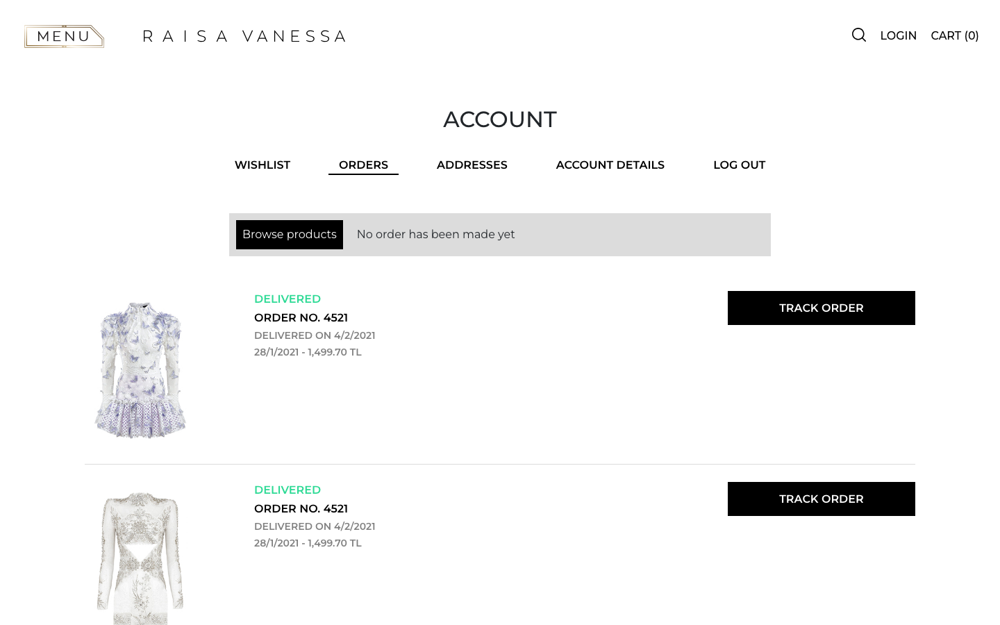 **Account:** orders with delivery status and tracking | 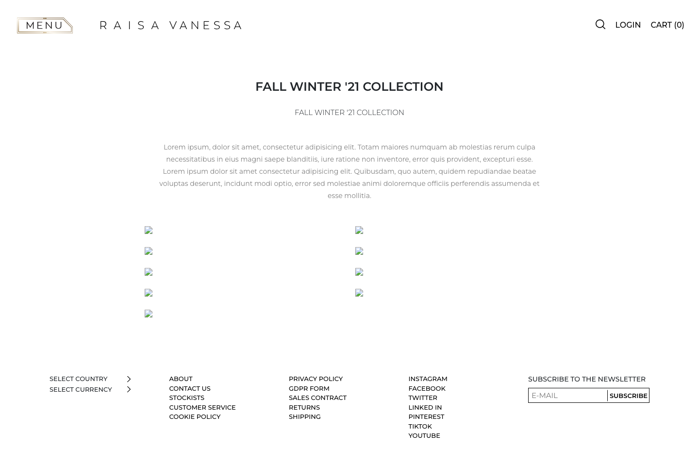 **Collection page** |

<p align="center">
  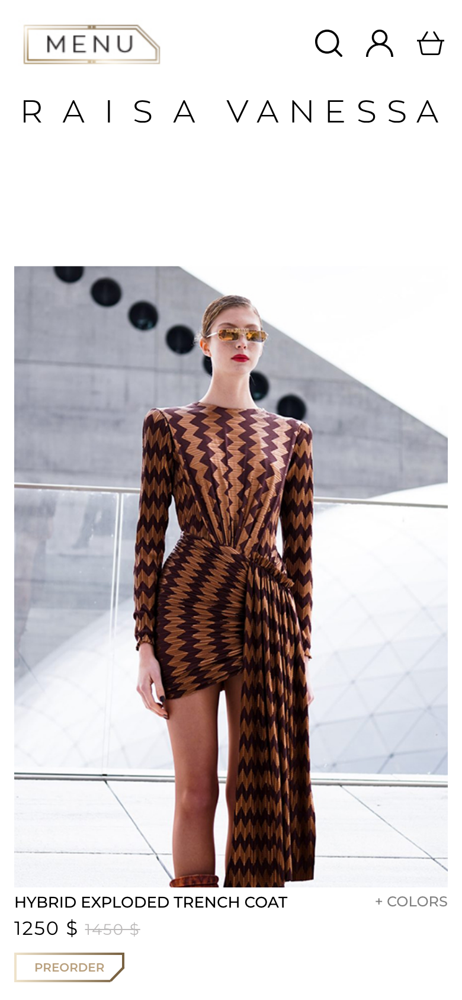
  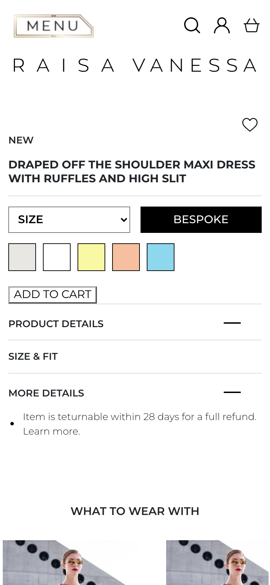
  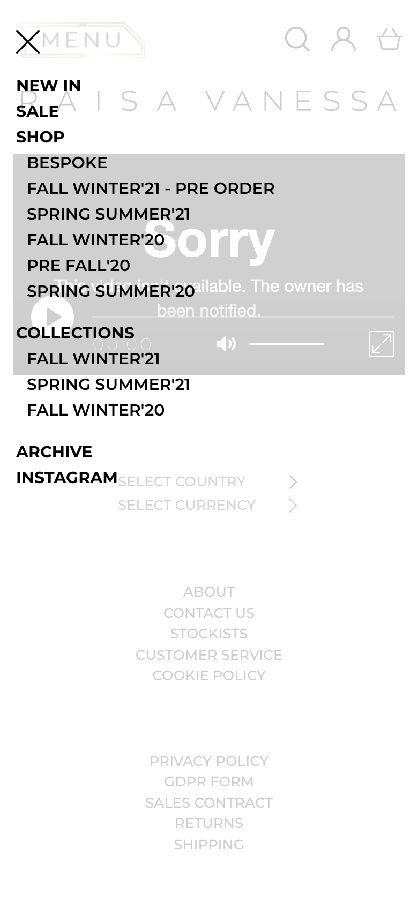
</p>

## Repository layout

```
storefront-templates/     static storefront: collections, listing, product, bespoke, cart, payment, account, stockists
app/
├── application/
│   ├── controllers/      storefront controllers + Admin/ (products, stock, orders, rates, CMS)
│   └── views/            storefront and admin views, mail templates
├── assets/Front/         CSS, JS, fonts
└── tr/                   Turkish storefront (separate CodeIgniter application)
docs/screenshots/
```

Models, configuration and the CodeIgniter `system/` folder were not preserved in the archive, so the application is shown as source rather than as a runnable project. The templates run on their own:

```bash
cd storefront-templates && php -d short_open_tag=On -S localhost:8084
```

## What I would do differently today

- **One app, real i18n.** The Turkish site is a copy of the application. Today it would be one codebase with translation files and locale routing.
- **Hosted payment fields.** Card details pass through the application server before reaching iyzico. Tokenised or hosted checkout keeps them out of scope entirely.
- **Typed storefront components** for the product, swatch, size and bag patterns, with image optimisation and lazy loading for the photography-heavy pages.

---

<sub>Built for Raisa Vanessa at MakingKnowing. Credentials and personal data have been removed and commercial documents (lookbooks) are not included. Shared for portfolio purposes; no license is granted for reuse.</sub>
